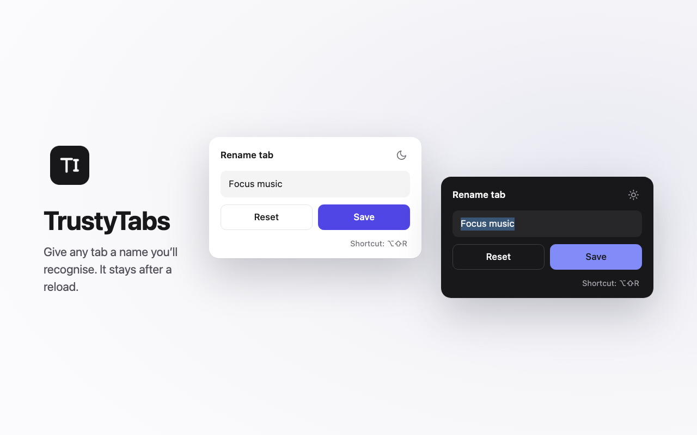

# TrustyTabs

Give any browser tab a name you'll recognise. The name stays after a reload, and every tab showing the same page gets it.

## Install (Chrome or Brave)

1. Open `chrome://extensions` (Brave: `brave://extensions`) and turn on **Developer mode**.
2. Click **Load unpacked** and choose this folder.

## Use

- Click the icon or press **⌥⇧R** (Alt+Shift+R on Windows and Linux).
- Type a name and press **Enter**.
- **Reset**, or saving an empty name, brings the original title back.
- **Shortcut** at the bottom of the popup opens the browser's shortcut settings, where you can change the keys.
- The moon/sun button switches between light and dark.

## What counts as the same page

The address without its `#hash`, tracking parameters (`utm_*`, `fbclid`, `gclid`…) and position parameters (YouTube's `t`, `si`, `pp`…). So a video shared with a timestamp still gets its name, while a different video on the same site keeps its own title.

## Privacy

No network access, no analytics. Names are saved only in the browser's local extension storage. The extension runs on every page only to put your saved name back on the tab.

## Files

| File | Job |
| --- | --- |
| `manifest.json` | Permissions (`storage`, `activeTab`) and the shortcut |
| `key.js` | Turns an address into the "same page" key |
| `content.js` | Keeps the saved name on the tab, also when the site changes its own title |
| `popup.html`, `popup.js` | The rename box |
| `theme.js` | Light/dark toggle |

## License

Copyright (c) 2026 zkrogfoss. [MIT](LICENSE), without any warranty.
