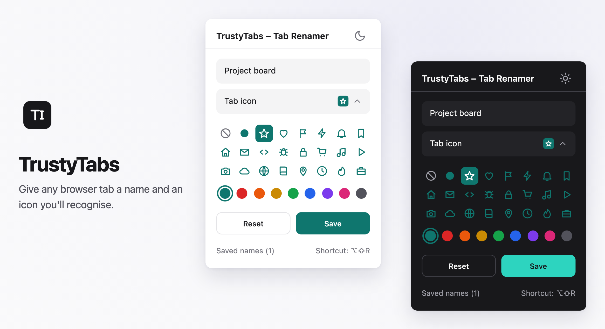

# TrustyTabs

Give any browser tab a name you'll recognise. The name stays after a reload, and every tab showing the same page gets it.

## Install (Chrome or Brave)

1. Open `chrome://extensions` (Brave: `brave://extensions`) and turn on **Developer mode**.
2. Click **Load unpacked** and choose this folder.

## Use

- Click the icon or press **⌥⇧R** (Alt+Shift+R on Windows and Linux).
- Type a name and press **Enter**.
- **Tab icon** (optional): pick an icon, then a colour, and press **Save**. The icons are drawn by the extension itself; nothing is downloaded or uploaded. "Site's own icon" leaves the site's icon alone.
- **Reset** brings the original title and icon back.
- **Shortcut** at the bottom of the popup opens the browser's shortcut settings, where you can change the keys.
- The moon/sun button switches between light and dark.

## What counts as the same page

The address without its `#hash`, tracking parameters (`utm_*`, `fbclid`, `gclid`…) and position parameters (YouTube's `t`, `si`, `pp`…). So a video shared with a timestamp still gets its name, while a different video on the same site keeps its own title.

## Privacy

No network access, no analytics. Saved in the browser's local extension storage, and only there: for each page you changed, its address, the name you gave it, and the id of the icon and colour you picked (for example `star` and `teal`). The extension runs on every page only to put your saved name and icon back on the tab. While a tab icon is active, the site's own icon link is taken out of the page and put back on Reset.

Permissions: `storage` keeps the names and icons; `activeTab` lets the popup read the current tab's address and title when you click the icon.

## Files

| File | Job |
| --- | --- |
| `manifest.json` | Permissions (`storage`, `activeTab`) and the shortcut |
| `key.js` | Turns an address into the "same page" key |
| `content.js` | Keeps the saved name and icon on the tab, also when the site changes its own title or icon |
| `icons.js` | The fixed list of icons and colours, and the check of what storage holds |
| `popup.html`, `popup.js` | The rename box and the icon picker |
| `options.html`, `options.js` | "Saved names": list, search and remove |
| `popup.css`, `theme.js` | Shared look, light/dark toggle |

## License

Copyright (c) 2026 zkrogfoss. [MIT](LICENSE), without any warranty.
